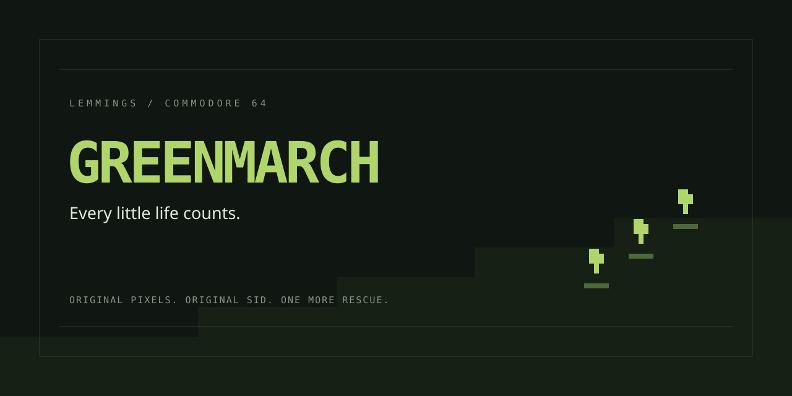
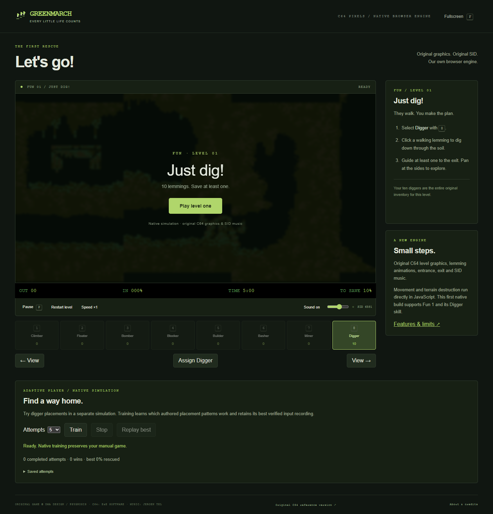

# GreenMarch

## [▶ Play GreenMarch online](https://soulspawnz.github.io/GreenMarch/)

**Every little life counts.** A native browser recreation of C64 Lemmings,
starting with **Fun 1 — Just dig!** Original level graphics, lemming animations
and SID music, with our own JavaScript gameplay engine.

The normal game runs without a C64 emulator, ROMs or disk loading. Original
music uses a separate, audio-only 6502/SID player. No installation is required.

## Play

Click **Play level one**. Select **Digger** with **8**, then click a walking
lemming to dig through the soil. There are 10 lemmings, 10 Diggers and five
minutes. Rescue at least one to complete the original 10% requirement.

Use **Speed ×4** to advance time faster. **Restart level** starts a fresh native
simulation. This build supports the first level and its Digger skill; other
skills and levels are not ported yet.

## Controls

| Input | Action |
| --- | --- |
| Mouse / touch | Point and click a walking lemming to assign Digger |
| Arrow keys | Move the crosshair; approach an edge to pan |
| Space / Assign Digger | Assign at the current crosshair |
| 8 | Select Digger |
| P | Pause / resume |
| F | Toggle fullscreen |
| View buttons | Pan across the original terrain |

Sound and volume controls operate the original SID player. Pause freezes
gameplay and silences audio.

## Adaptive Player

Choose an attempt count and **Train** below the game. A separate simulation
worker tests digger placements and learns their returns, keeping your manual
game intact. **Replay best** plays its verified, recorded simulation-tick inputs.
Saved attempts survive reload; **Export experience** downloads the local archive.

The first native training check found and reproduced a **90% rescue**. This is
a small placement learner, not a general solver. [Features, checks and limits](docs/NATIVE_ENGINE.md).

## Original C64 reference

The earlier [100-level reference build](https://soulspawnz.github.io/GreenMarch/emulator-reference.html)
runs the original game in VICE, including its loading, title, manual-code and
result screens. It remains separate from the native recreation for comparison.

## Play locally

With Node.js 18 or newer, run `npm start` and open
[localhost:8768](http://127.0.0.1:8768/). No package installation or build is required.
[Development and testing](docs/DEVELOPMENT.md).

## Credits

Original game: DMA Design / Psygnosis. C64 conversion: E&E Software. Original
SID music: Jeroen Tel. GreenMarch code/artwork and third-party components retain
their respective licenses; original game assets retain their original rights.
[Full credits](docs/ORIGINAL_MEDIA.md) · [Features and limits](docs/NATIVE_ENGINE.md).
